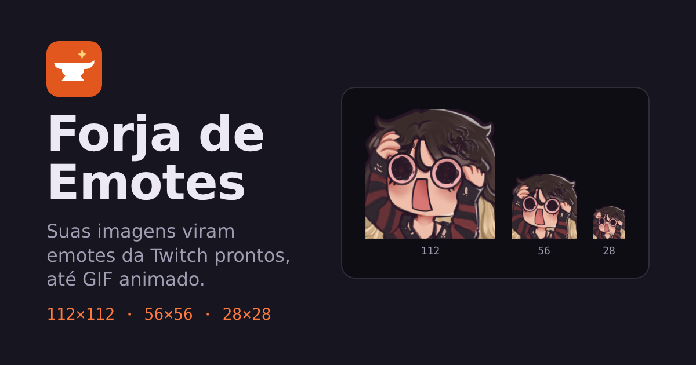

# Forja de Emotes

Transforme suas imagens em emotes prontos para a Twitch: cada imagem sai em **112×112**, **56×56** e **28×28**, num único `.zip`. Funciona com PNG, JPG, WEBP e **GIF animado**.

**Acesse:** https://aldenirtakeshi.github.io/forja-de-emotes/



## Recursos

- Envio de várias imagens de uma vez (arrastar, clicar ou colar com Ctrl+V)
- Escolha de quais tamanhos exportar (só 112, só 56, todos…)
- Preset de insígnias (72×72, 36×36, 18×18)
- **Editor de corte**: arraste e dê zoom para enquadrar cada emote
- **GIF animado** exportado como GIF nos três tamanhos, com transparência
- Prévia no chat claro e escuro, inclusive no tamanho real de 28 px
- Redução em etapas para bordas limpas, modo pixel art e remoção de borda transparente
- Aviso quando um arquivo passa de 1 MB (limite da Twitch)
- Tudo roda no navegador: nenhuma imagem é enviada para servidor

## Como usar

1. Solte as imagens na página.
2. Se precisar, clique em **Enquadrar** para ajustar o corte.
3. Marque os tamanhos em **Exportar** e clique em **Baixar todos (.zip)**.

## Rodar localmente

Não precisa de build nem dependências. Basta abrir o `index.html` no navegador.

Se preferir um servidor local:

```bash
npx serve .
# ou
python -m http.server 8000
```

## Estrutura

```
index.html          página
css/style.css       estilos (tema claro e escuro)
js/app.js           interface, lista de emotes e exportação
js/render.js        corte, zoom e redimensionamento
js/gif.js           leitura e escrita de GIF animado
js/cropper.js       editor de corte
js/zip.js           geração do .zip
js/exemplo.js       emote de exemplo embutido
vendor/             bibliotecas de GIF (gifuct-js e gifenc)
assets/             ícone, imagem de compartilhamento e exemplo
```

## Créditos

- [gifuct-js](https://github.com/matt-way/gifuct-js) para ler GIFs (MIT)
- [gifenc](https://github.com/mattdesl/gifenc) para gerar GIFs (MIT)

Licenças completas em [`vendor/LICENSES.md`](vendor/LICENSES.md).

Projeto independente, sem vínculo com a Twitch.

## Licença

[MIT](LICENSE) © Aldenir dos Santos (Takeshi)
